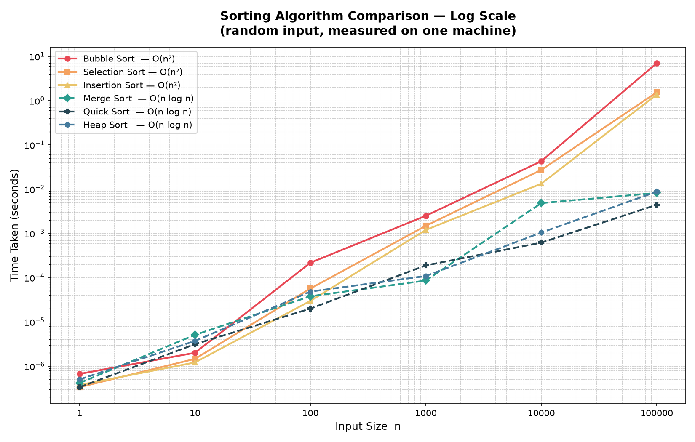

# DAA Assignment 1 — Sorting Algorithms

**Design & Analysis of Algorithms — Assignment 1**

Empirical comparison of six classic sorting algorithms across input sizes `1`, `10`, `100`, `1000`, `10000`, `100000` on random integer arrays.

## Algorithms Implemented

| File | Algorithm | Complexity |
|---|---|---|
| `Bubble.cpp` | Bubble Sort | O(n²) |
| `Selection.cpp` | Selection Sort | O(n²) |
| `Insertion.cpp` | Insertion Sort | O(n²) |
| `Merge.cpp` | Merge Sort | O(n log n) |
| `Quick.cpp` | Quick Sort | O(n log n) avg |
| `Heap.cpp` | Heap Sort | O(n log n) |
| `Sort.cpp` | Driver / Timing Harness | -- |
| `PlotGraph.py` | Log scale graph plotter | -- |

## How to Run

**1 — Compile & time all algorithms**

```bash
cd Assignment_1
g++ *.cpp -o Sort
./Sort
```

**2 — Generate the log-scale graph**

```bash
cd Assignment_1
pip install matplotlib      # only once
python3 PlotGraph.py
# -> sorting_comparison_logscale.png is created
```

## Timing Table (seconds, random input)

| n | Bubble | Selection | Insertion | Merge | Quick | Heap |
|---|---|---|---|---|---|---|
| 1 | 6.67e-7 | 3.34e-7 | 3.75e-7 | 4.16e-7 | 3.34e-7 | 5.00e-7 |
| 10 | 2.00e-6 | 1.46e-6 | 1.21e-6 | 5.08e-6 | 3.13e-6 | 3.71e-6 |
| 100 | 2.17e-4 | 5.68e-5 | 2.98e-5 | 3.79e-5 | 2.00e-5 | 4.84e-5 |
| 1000 | 2.50e-3 | 1.48e-3 | 1.20e-3 | 8.59e-5 | 1.89e-4 | 1.09e-4 |
| 10000 | 4.28e-2 | 2.71e-2 | 1.32e-2 | 4.83e-3 | 6.17e-4 | 1.04e-3 |
| 100000 | 6.999 | 1.539 | 1.372 | 0.0082 | 0.0044 | 0.0087 |

## Log-Scale Comparison Graph



## Write-up: O(n²) vs O(n log n) Behaviour

The empirical results closely mirror the theoretical complexities of each algorithm. For small inputs (n ≤ 100), all six algorithms finish in microseconds and the differences are negligible. The divergence becomes clearly visible at n = 1000.

By n = 10000, Bubble Sort already takes ~43 ms while Quick Sort finishes in ~0.6 ms — a 70× gap. At n = 100000, the gap becomes catastrophic: Bubble Sort required ~7 seconds, Selection Sort ~1.5 s, and Insertion Sort ~1.4 s. Meanwhile, Merge Sort, Quick Sort, and Heap Sort all finished in under 9 milliseconds — roughly 800-1600× faster than Bubble Sort.

This dramatic difference is exactly what the theoretical models predict. O(n²) algorithms perform roughly n² = 10 000 000 000 operations for n = 100000, while O(n log n) algorithms perform only ~n·log₂(n) = 1 700 000 — about 6000× fewer operations. Quick Sort was empirically the fastest due to small constant factors and excellent cache locality. Insertion Sort outperformed Bubble and Selection because its inner loop terminates early once the correct position is found. Heap Sort was slightly slower than Merge Sort at this size due to its poor cache access patterns.

**Conclusion**: For large datasets, O(n log n) algorithms are not just theoretically superior — they are practically indispensable.

## Repository Structure

```
DAA/
└── Assignment_1/
    ├── Bubble.cpp
    ├── Selection.cpp
    ├── Insertion.cpp
    ├── Merge.cpp
    ├── Quick.cpp
    ├── Heap.cpp
    ├── Sort.cpp
    ├── PlotGraph.py
    ├── sorting_comparison_logscale.png
    └── README.md
```
